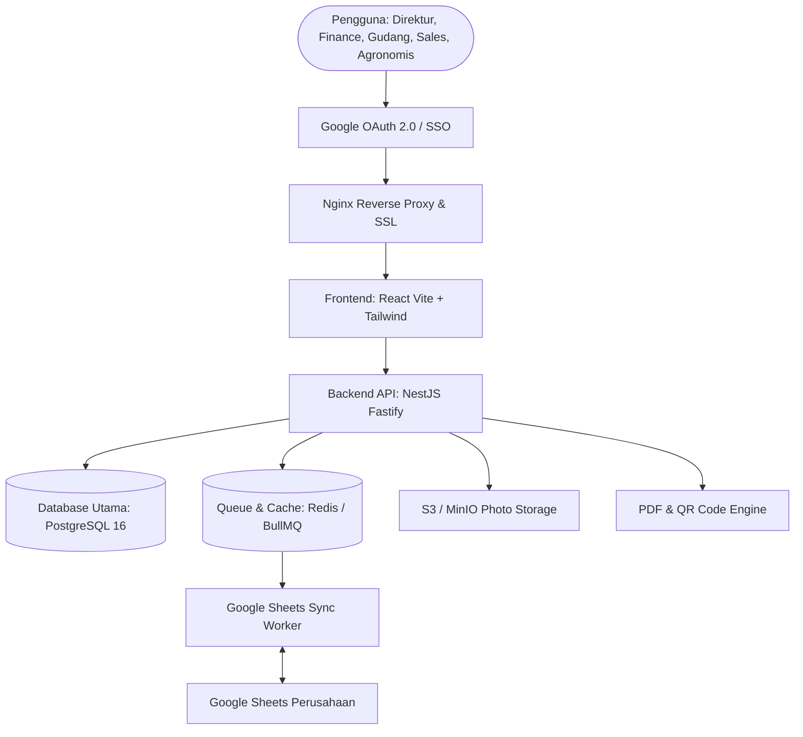
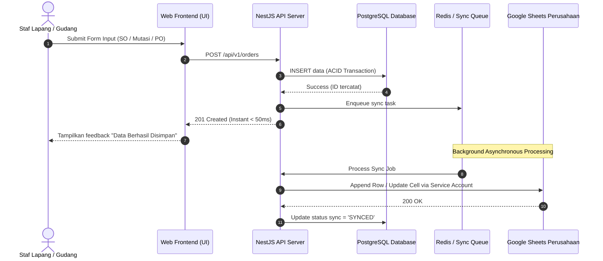
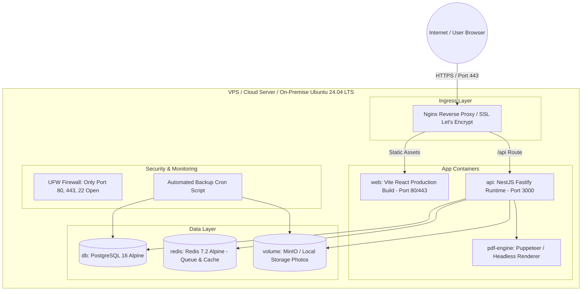
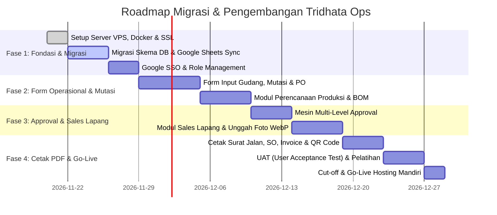

# DOKUMEN ARSITEKTUR & INFRASTRUKTUR SISTEM (SYSTEM INFRASTRUCTURE & ARCHITECTURE SPECIFICATION)
## Proyek: Tridhata Ops — Enterprise Resource Management (Bogor & Cabang Nganjuk)

---

## 1. Executive Summary & Latar Belakang

### 1.1 Kondisi Saat Ini (Current State)
* Sistem operasional berjalan dalam bentuk **satu file HTML monolitik** yang berinteraksi langsung dengan Google Sheets perusahaan.
* Lingkungan eksekusi masih terikat pada lingkungan sandbox sementara (`claude.ai`), sehingga tidak memiliki kedaulatan data, tidak memiliki jaminan uptime independen, dan rentan terhadap pembatasan kuota eksternal.
* Interaksi langsung client-side ke Google Sheets menimbulkan risiko serius:
  1. *Race Condition*: Penulisan data simultan dari staf gudang, sales, dan produksi di dua lokasi berbeda rawan menimpa (*overwrite*) data baris.
  2. *API Quota Throttling*: Limit kuota baca/tulis Google Sheets API (60 read/write per user/menit) rentan memicu error `429 Too Many Requests`.
  3. *Ketiadaan Transaksi ACID*: Jika proses simpan gagal di tengah jalan, integritas data menjadi korup tanpa mekanisme rollback.
  4. *Ketiadaan Audit Trail*: Tidak ada jejak siapa yang mengubah data, kapan, dan dari mana.

### 1.2 Target & Visi Sistem Baru (Target State)
* **Kedaulatan Sistem Penuh (Self-Hosted)**: Aplikasi internal mandiri di infrastruktur server milik sendiri (VPS / On-Premise Docker).
* **Kesinambungan Google Sheets (Zero Disruption)**: Staf input melalui form web terstruktur yang jauh lebih mudah dan aman, namun data tetap tersinkronisasi dua arah ke kolom spreadsheet perusahaan yang sudah ada.
* **Multi-Lokasi Simetris**: Mendukung operasional Pabrik Bogor dan Cabang Nganjuk dengan partisi data (*data isolation*) yang ketat per lokasi.
* **Enterprise Features**: Google SSO, Multi-stage Approval, Real-time KPI Dashboard, Headless PDF/Barcode/QR Generator, dan Compressed Photo Storage.

---

## 2. Analisa Kebutuhan Sistem & Matriks Modul (~40 Menu)

Sistem internal melayani 8 modul utama yang berlaku untuk kedua lokasi (Bogor & Nganjuk):

### 2.1 Dekomposisi 8 Modul & 40 Fitur Operasional

| No | Modul | Menu & Fitur Utama | Hak Akses Utama (Role) |
| :--- | :--- | :--- | :--- |
| **1** | **Dashboard & Ringkasan** | Executive Summary, KPI Penjualan, Capaian Target Produksi Harian/Bulanan, Indikator Kesehatan Stok (Aman/Kritis/Habis). | Direktur, Finance, Admin, Kepala Pabrik |
| **2** | **Finance & Approval** | Approval Multi-Tahap Diskon Penjualan, Plafon Kredit Pelanggan, Pengajuan Dana Operasional Kasbon, Rekonsiliasi Pembayaran. | Direktur, Finance, Sales Manager |
| **3** | **Pengajuan Pembelian & Transfer Gudang** | Purchase Requisition (PR), Purchase Order (PO) Bahan Baku, Pengajuan Transfer Antar-Gudang (Bogor <-> Nganjuk), Surat Jalan Transfer. | Purchasing, Gudang, Kepala Pabrik |
| **4** | **Mutasi Stok (Inventory)** | Penerimaan Barang Masuk (GRN), Pengeluaran Barang Jadi, Kartu Stok Digital, Stock Opname Harian/Bulanan, Log Selisih Stok. | Staf Gudang, Kepala Gudang, Audit |
| **5** | **Perencanaan & Produksi** | Surat Perintah Kerja (SPK), Bill of Materials (BOM), Catatan Batch Produksi harian, Hasil Produksi Jadi, Label Batch & QR. | Staf Produksi, QC, Supervisor Pabrik |
| **6** | **Sales & Marketing** | Sales Order (SO), Katalog Produk & Harga, Database Pelanggan/Distributor, Surat Jalan Pengiriman, Invoice Penjualan. | Admin Sales, Sales B2B, Finance |
| **7** | **Sales Lapang & Agronomis** | Check-in Kunjungan Petani/Kios, Log Demo Plot (Demplot), Pelaporan Hama/Kondisi Tanaman, Unggah Foto Lapang dengan Geotag. | Sales Lapang, Agronomis, Koordinator Lapang |
| **8** | **Database & Sistem** | Master Produk & SKU, Master Pengguna & Hak Akses Peran, Pemetaan Kolom Google Sheets, Log Audit Keamanan. | Super Admin, IT Internal |

---

## 3. Desain Arsitektur Rekomendasi (Best Practice)

### 3.1 Pola "Database-First with Asynchronous Sync" (Solusi Masalah Google Sheets)
Alih-alih membuat web yang menulis langsung ke Google Sheets (yang lambat dan rentan *timeout*):
1. **Langkah 1 (Fast Transaction)**: Saat user submit form (misal: Penerimaan Barang atau Sales Order), data divalidasi dan disimpan langsung ke **PostgreSQL** dalam waktu **< 50 milidetik**.
2. **Langkah 2 (User Feedback)**: User langsung menerima notifikasi sukses seketika tanpa menunggu koneksi ke Google.
3. **Langkah 3 (Event-Driven Outbox Queue)**: Backend memicu event ke worker antrean (**BullMQ / Redis**). Worker bertugas menuliskan baris baru tersebut ke spreadsheet Google Sheets perusahaan pada baris dan kolom yang persis sama.
4. **Resilience**: Jika Google Sheets sedang offline atau kuota API penuh, antrean akan otomatis mencoba lagi (*exponential backoff retry* hingga 5 kali) tanpa mengganggu kerja user di aplikasi web.

---

## 4. Rincian Fitur Utama & Spesifikasi Teknis

### 4.1 Login Akun Google & Granular RBAC
* **Autentikasi**: Google OAuth 2.0 / OpenID Connect (OIDC).
  * User mengklik *"Masuk dengan Akun Google"*.
  * Sistem memverifikasi domain email (misal: `@tridhata.com` atau daftar email terverifikasi di database).
* **Otorisasi**: Token JWT bervariasi dengan hak akses (*permissions*) spesifik:
  * `DIRECTOR`: Hak akses menyeluruh (*full view*, *final approval* semua nilai limit).
  * `FINANCE`: Akses laporan keuangan, *approval* diskon, rekonsiliasi pembayaran.
  * `WAREHOUSE`: Input mutasi stok, penerimaan barang, cetak surat jalan.
  * `SALES_FIELD`: Form kunjungan lapang, upload foto, draft Sales Order.

### 4.2 Form Input & Mesin Approval Multi-Tahap (Multi-Level State Machine)
Setiap pengajuan bernilai sensitif (misal: Diskon Penjualan > 5%, Pengajuan Pembelian > Rp 10 Juta, Mutasi Transfer Gudang) melewati alur persetujuan:
* **State Machine**:
  `DRAFT` $\rightarrow$ `SUBMITTED` $\rightarrow$ `PENDING_SUPERVISOR` $\rightarrow$ `PENDING_FINANCE` $\rightarrow$ `PENDING_DIRECTOR` $\rightarrow$ `APPROVED` (atau `REJECTED`).
* **Fitur Kunci**:
  * *Audit Trail Lengkap*: Mencatat siapa yang menyetujui, tanggal & jam, nominal yang disetujui, dan catatan alasan penolakan/persetujuan.
  * *Separation of Duties*: Pembuat pengajuan (*requester*) dilarang menyetujui pengajuannya sendiri.
  * *Notifikasi*: Indikator badge di web dashboard secara real-time.

### 4.3 Pembuatan Dokumen PDF Operasional & QR Code Batch
* **Dokumen yang dicetak**:
  1. Surat Jalan Pengiriman (Standar 3 Rangkap: Pembeli, Gudang, Arsip).
  2. Invoice / Faktur Penjualan.
  3. Sales Order (SO) Confirmation.
  4. Label Batch Produk (Ukuran Thermal 100x150 mm atau Sticker A4).
* **Mesin Generator PDF**:
  * Template menggunakan HTML + CSS print-ready (`@media print` atau *headless Chrome/Puppeteer microservice*).
  * Cepat, layout presisi millimeter, bebas bergantung pada aplikasi desktop pihak ketiga.
* **Integrasi QR Code**:
  * Library generator QR lokal (`qrcode`).
  * Setiap batch produksi / surat jalan disematkan kode QR unik berisi URL verifikasi internal:
    `https://ops.tridhata.com/verify/batch/{batchNumber}` atau data terenkripsi untuk mempermudah scan menggunakan HP staf gudang.

### 4.4 Layanan Unggah Foto & Dokumen Lapang (Optimal & Hemat Storage)
* **Permasalahan Lapang**: Foto dari kamera smartphone agronomis/sales biasanya berukuran 5 MB – 12 MB. Mengunggah ribuan foto mentah akan membuat server kehabisan disk dan kuota bandwidth membengkak.
* **Arsitektur Optimal**:
  1. *Client-side / Middleware Compression*: Foto otomatis dikonversi ke format WebP modern dengan resolusi maksimum 1600px dan kualitas 80% (ukuran menyusut menjadi **200 KB – 400 KB** tanpa kehilangan detail bukti lapangan).
  2. *Penyimpanan*:
     * Fase Awal: Local Docker Volume terisolasi dengan proteksi Nginx static server.
     * Fase Skala: S3-Compatible Storage (Cloudflare R2 atau MinIO Self-Hosted) yang gratis/sangat murah untuk egress bandwidth.
  3. *Tautan*: URL foto tersimpan di PostgreSQL dan disinkronkan ke kolom Google Sheets sebagai link yang dapat diklik oleh direksi.

---

## 5. Rencana Infrastruktur Hosting (Self-Hosted Deployment Blueprint)

### 5.1 Topologi Server (Docker Compose Architecture)
Infrastruktur dirancang menggunakan containerization berbasis Docker untuk memastikan kemudahan instalasi, isolasi layanan, kemudahan backup, dan portabilitas antar server.

### 5.2 Spesifikasi Kebutuhan Server (Hardware Requirements)

| Lingkungan | CPU | RAM | Penyimpanan (SSD/NVMe) | Rekomendasi Provider | Estimasi Biaya |
| :--- | :--- | :--- | :--- | :--- | :--- |
| **Fase 1: Produksi (Rekomendasi Utama)** | 2 vCPU | 4 GB | 50 GB NVMe | DigitalOcean / Linode / Hetzner / VPS Lokal ID (Biznet, IDCloudHost) | ~Rp 250.000 – Rp 400.000 / bulan |
| **Fase 2: Skala Menengah (Bila foto > 50 GB)** | 4 vCPU | 8 GB | 100 GB NVMe + Object Storage | Cloud VPS + Cloudflare R2 | ~Rp 600.000 / bulan |

---

## 6. Prosedur Keamanan, Backup, dan Disaster Recovery (SOP)

1. **Keamanan Jaringan & Data**:
   * Seluruh lalu lintas data diwajibkan menggunakan enkripsi **HTTPS/TLS 1.3** dengan sertifikat SSL otomatis dari Let's Encrypt.
   * Port database (PostgreSQL 5432/5433) dan Redis (6379) ditutup dari internet publik (hanya bisa diakses secara internal antar-container di Docker Network).
   * Kredensial sensitif (*Google Service Account Private Key, Database Password, JWT Secret*) disimpan aman dalam file environment `.env` dengan *permission* `chmod 600`.

2. **Strategi Backup Otomatis (3-2-1 Backup Strategy)**:
   * **Database Backup Harian**: Cron job berjalan setiap pukul 02:00 WIB untuk melakukan `pg_dump` otomatis.
   * **Rotasi Backup**: File backup dikompresi (`.sql.gz`), dienkripsi, dan disimpan selama 30 hari terakhir.
   * **Offsite Backup**: File backup database dan media foto otomatis disinkronkan ke cloud backup terpisah (misal: Google Drive terisolasi atau bucket S3) sehingga jika server fisik mengalami kerusakan fatal, seluruh sistem dapat dipulihkan (*restore*) dalam waktu kurang dari 30 menit.

---

## 7. Roadmap Implementasi Bertahap (Phased Rollout Plan)

---

## 8. Kesimpulan & Rekomendasi Utama

1. **Pemindahan dari claude.ai ke VPS Mandiri adalah langkah yang sangat tepat** untuk menjamin kestabilan operasional harian perusahaan, menjaga kerahasiaan data bisnis, dan menghilangkan ketergantungan pada platform pihak ketiga.
2. **Tetap pertahankan integrasi dengan Google Sheets** namun ubah polanya menjadi *Database-First Asynchronous Sync*. Hal ini membuat pengisian form oleh staf lapang dan staf pabrik menjadi sangat kencang tanpa hambatan (*zero loading timeout*), sementara rekapitulasi di Google Sheets perusahaan tetap terisi otomatis dan rapi.
3. Seluruh arsitektur yang dirancang di atas **kompatibel 100% dengan codebase monorepo Tridhata Ops saat ini** (`apps/web` React + `apps/api` NestJS Fastify + PostgreSQL + Prisma), sehingga migrasi dapat dilakukan secara mulus tanpa memulai dari nol.
