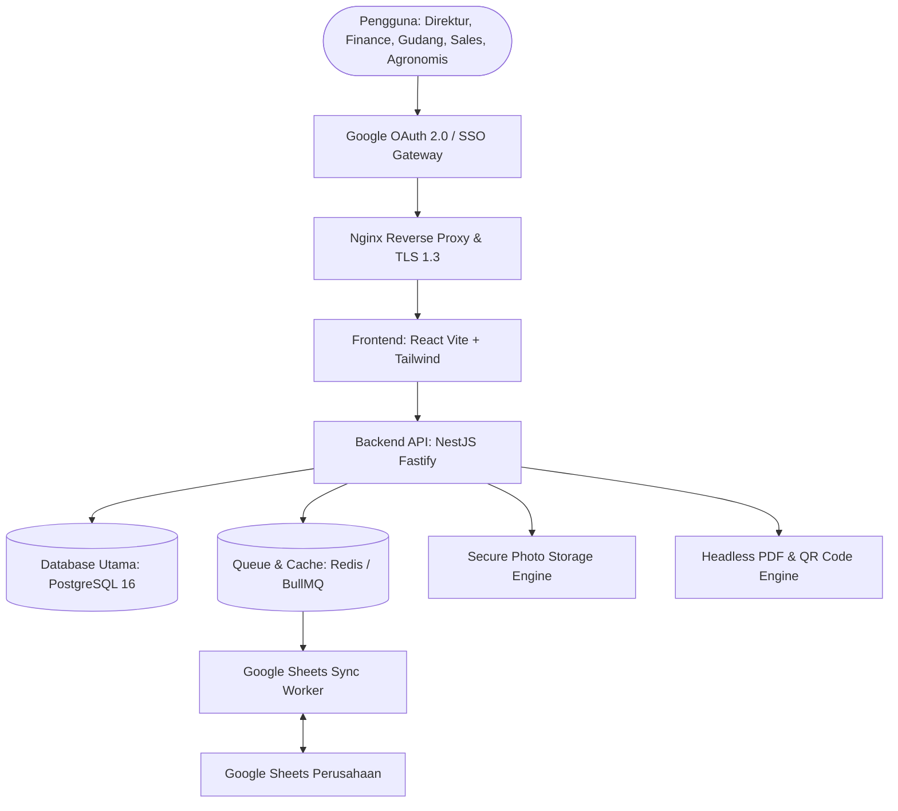
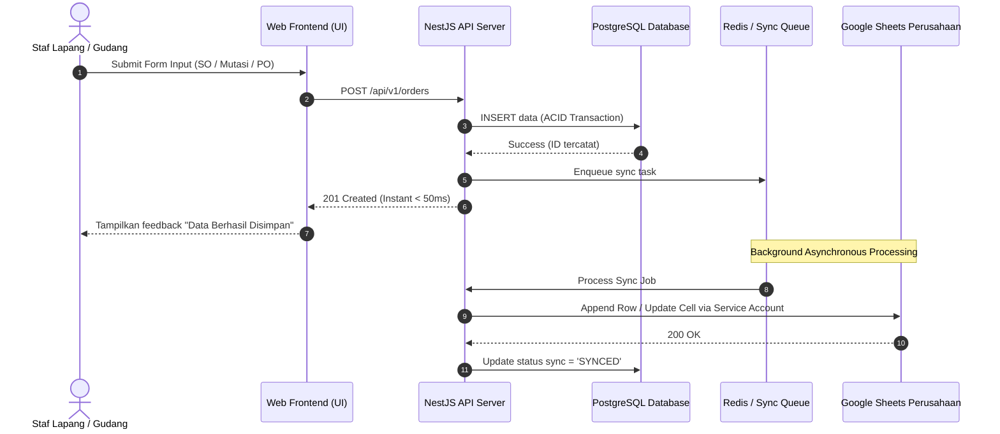
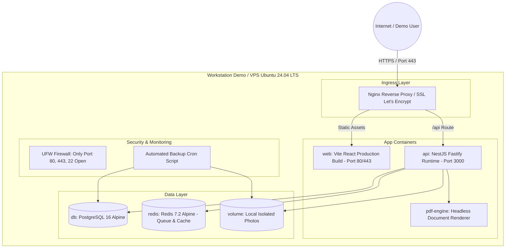

# DOKUMEN ARSITEKTUR, INFRASTRUKTUR & KEAMANAN SISTEM
## Proyek: Tridhata Ops — Enterprise Resource Management (Bogor & Cabang Nganjuk)
### Klasifikasi: Dokumen Internal & Spesifikasi Teknis

---

## 1. Executive Summary & Visi Sistem

### 1.1 Kondisi Saat Ini (Current State)
* Sistem operasional sebelumnya berjalan dalam bentuk **satu file HTML monolitik** yang berinteraksi langsung dengan Google Sheets perusahaan.
* Lingkungan eksekusi sebelumnya terikat pada lingkungan sandbox sementara (`claude.ai`), sehingga tidak memiliki kedaulatan data, rentan terhadap pembatasan kuota eksternal, dan tidak memiliki perlindungan transaksi ACID.
* Interaksi langsung client-side ke Google Sheets menimbulkan risiko serius:
  1. *Race Condition*: Penulisan data simultan dari staf gudang, sales, dan produksi berisiko menimpa (*overwrite*) data baris.
  2. *API Quota Throttling*: Kuota Google Sheets API (60 read/write per user/menit) rentan memicu galat `429 Too Many Requests`.
  3. *Ketiadaan Transaksi ACID*: Jika proses simpan terputus di tengah jalan, data menjadi korup tanpa kemampuan rollback otomatis.
  4. *Ketiadaan Audit Trail*: Tidak ada catatan akuntabilitas mengenai siapa yang mengubah data, kapan, dan dari alamat IP mana.

### 1.2 Target Sistem & Tahapan Implementasi
* **Fase 1: Mode Demo & Validasi Klien (Kondisi Sekarang)**
  * Sistem berjalan aman secara lokal (*Localhost / Private Network*) dengan biaya infrastruktur **Rp 0 (Nol Rupiah)**.
  * Seluruh modul, form, dashboard, dan alur approval dapat diuji coba dan didemonstrasikan langsung menggunakan workstation/laptop tanpa ketergantungan sewa server luar.
* **Fase 2: Hosting Mandiri Produksi (Saat Go-Live Masa Depan)**
  * Sistem dipindahkan ke server mandiri (VPS Linux / On-Premise Docker) berdomain internal (misal: `ops.tridhata.com`).
  * Tetap mempertahankan kesinambungan Google Sheets (*zero disruption*) di mana form web mengisi database lokal terlebih dahulu, lalu worker latar belakang menyinkronkannya ke kolom Google Sheets perusahaan yang sudah ada.

---

## 2. Analisa Kebutuhan Sistem & Matriks Modul (~40 Menu)

Sistem internal melayani 8 modul utama yang berlaku simetris untuk kedua lokasi (Bogor & Nganjuk):

### 2.1 Dekomposisi 8 Modul & 40 Fitur Operasional

| No | Modul | Menu & Fitur Utama | Hak Akses Utama (Role) |
| :--- | :--- | :--- | :--- |
| **1** | **Dashboard & Ringkasan** | Executive Summary, KPI Penjualan, Capaian Target Produksi Harian/Bulanan, Indikator Kesehatan Stok (Aman/Kritis/Habis). | Direktur, Finance, Admin, Kepala Pabrik |
| **2** | **Finance & Approval** | Approval Multi-Tahap Diskon Penjualan, Plafon Kredit Pelanggan, Pengajuan Dana Operasional Kasbon, Rekonsiliasi Pembayaran. | Direktur, Finance, Sales Manager |
| **3** | **Pengajuan Pembelian & Transfer Gudang** | Purchase Requisition (PR), Purchase Order (PO) Bahan Baku, Pengajuan Transfer Antar-Gudang (Bogor <-> Nganjuk), Surat Jalan Transfer. | Purchasing, Gudang, Kepala Pabrik |
| **4** | **Mutasi Stok (Inventory)** | Penerimaan Barang Masuk (GRN), Pengeluaran Barang Jadi, Kartu Stok Digital, Stock Opname Harian/Bulanan, Log Selisih Stok. | Staf Gudang, Kepala Gudang, Audit |
| **5** | **Perencanaan & Produksi** | Surat Perintah Kerja (SPK), Bill of Materials (BOM), Catatan Batch Produksi harian, Hasil Produksi Jadi, Label Batch & QR. | Staf Produksi, QC, Supervisor Pabrik |
| **6** | **Sales & Marketing** | Sales Order (SO), Katalog Produk & Harga, Database Pelanggan/Distributor, Surat Jalan Pengiriman, Invoice Penjualan. | Admin Sales, Sales B2B, Finance |
| **7** | **Sales Lapang & Agronomis** | Check-in Kunjungan Petani/Kios, Log Demo Plot (Demplot), Pelaporan Hama/Kondisi Tanaman, Unggah Foto Lapang dengan Geotag. | Sales Lapang, Agronomis, Koordinator Lapang |
| **8** | **Database & Sistem** | Master Produk & SKU, Master Pengguna & Hak Akses Peran, Pemetaan Kolom Google Sheets, Log Audit Keamanan. | Super Admin, IT Internal |

---

## 3. Desain Arsitektur Rekomendasi (Best Practice)

### 3.1 Pola "Database-First with Asynchronous Sync" (Solusi Masalah Google Sheets)
Alih-alih membuat web yang menulis langsung ke Google Sheets (yang lambat dan rentan *timeout*):
1. **Langkah 1 (Fast Transaction)**: Saat user submit form (misal: Penerimaan Barang atau Sales Order), data divalidasi dan disimpan langsung ke **PostgreSQL** dalam waktu **< 50 milidetik**.
2. **Langkah 2 (User Feedback)**: Layar user langsung menampilkan notifikasi sukses seketika tanpa menunggu koneksi Google Sheets.
3. **Langkah 3 (Event-Driven Outbox Queue)**: Backend memicu event ke worker antrean (**BullMQ / Redis**). Worker bertugas menuliskan baris baru tersebut ke spreadsheet Google Sheets perusahaan pada baris dan kolom yang persis sama.
4. **Resilience**: Jika Google Sheets sedang offline atau kuota API penuh, antrean akan otomatis mencoba lagi (*exponential backoff retry* hingga 5 kali) tanpa mengganggu pekerjaan user.

---

## 4. Kerangka Kerja Keamanan Sistem (Security & Safety Framework)

Dokumen ini menetapkan standar keamanan operasional (*Defense in Depth*) agar data bisnis Tridhata terlindungi secara penuh:

### 4.1 Pencegahan Formula Injection pada Google Sheets
Saat pengguna memasukkan data teks (misal: catatan keterangan atau nama pelanggan) yang diawali karakter khusus matematika seperti `=`, `+`, `-`, atau `@`, spreadsheet Google Sheets dapat menginterpretasikannya sebagai rumus eksekusi berbahaya (*CSV/Formula Injection*).
* **Mekanisme Proteksi**: Backend secara otomatis memfilter dan menambahkan karakter kutip tunggal (`'`) di depan teks jika diawali karakter rumus sebelum dikirim ke Google Sheets API, memastikan data tersimpan murni sebagai teks biasa (*safe plain text*).

### 4.2 Isolasi Data Multi-Lokasi (Anti-IDOR / Tenant Boundary)
Untuk memastikan staf Pabrik Bogor tidak dapat melihat atau mengubah mutasi stok Pabrik Nganjuk:
* Setiap query database di level API wajib menyertakan filter `locationId` yang tervalidasi dari sesi token JWT pengguna.
* Pencegahan *Insecure Direct Object Reference* (IDOR): Backend memeriksa apakah pengguna berhak mengakses dokumen yang diminta berdasarkan hak lokasinya. Hanya role Direktur dan Finance yang memiliki wewenang lintas lokasi (*cross-location access*).

### 4.3 Keamanan Unggah Foto (File Upload Hardening)
Sales lapang dan staf gudang akan mengunggah bukti foto lapangan dan kondisi barang:
1. **Validasi Magic Bytes (Bukan Sekadar Ekstensi)**: Backend memeriksa byte header file (Magic Number) untuk memastikan file benar-benar gambar JPEG/PNG/WebP asli dan menolak file executable/script yang disamarkan.
2. **Pembersihan Metadata (EXIF Stripping)**: Metadata kamera pribadi otomatis dibersihkan saat proses kompresi WebP untuk menghemat ukuran dan menjaga privasi perangkat.
3. **Penyimpanan Terisolasi**: Folder upload diset dengan atribut sistem `noexec` (tidak dapat dieksekusi sebagai script program di server).

### 4.4 Keamanan Generator Dokumen PDF (Anti-SSRF)
* Generator PDF yang menggunakan mesin headless browser (Chromium/Puppeteer) rentan terhadap *Server-Side Request Forgery* (SSRF) jika me-render konten luar yang tidak terpercaya.
* **Mekanisme Proteksi**: Mesin PDF dijalankan dalam sandbox terisolasi dengan parameter `--disable-web-security=false`, memblokir protokol `file://`, dan memblokir akses ke alamat IP internal server (`127.0.0.1`, `169.254.169.254`). Seluruh template invoice dan surat jalan hanya merender HTML lokal yang telah divalidasi.

### 4.5 Prinsip Hak Akses Terkecil (Least Privilege pada Google Service Account)
* Akun Service Account Google Cloud **hanya diberikan izin akses (Viewer/Editor) ke file Google Sheets spesifik** yang digunakan untuk operasional.
* Service Account tidak diberikan akses ke folder Google Drive perusahaan lainnya, sehingga data internal perusahaan lainnya tetap aman 100%.

---

## 5. Rincian Fitur Utama Operasional

### 5.1 Login Akun Google & Granular RBAC
* **Autentikasi**: Google OAuth 2.0 / OpenID Connect (OIDC).
  * User mengklik *"Masuk dengan Akun Google"*.
  * Sistem memverifikasi domain email (misal: `@tridhata.com` atau daftar email terverifikasi di database).
* **Otorisasi**: Token JWT bervariasi dengan hak akses (*permissions*) spesifik:
  * `DIRECTOR`: Hak akses menyeluruh (*full view*, *final approval* semua nilai limit).
  * `FINANCE`: Akses laporan keuangan, *approval* diskon, rekonsiliasi pembayaran.
  * `WAREHOUSE`: Input mutasi stok, penerimaan barang, cetak surat jalan.
  * `SALES_FIELD`: Form kunjungan lapang, upload foto, draft Sales Order.

### 5.2 Form Input & Mesin Approval Multi-Tahap (Multi-Level State Machine)
Setiap pengajuan bernilai sensitif (misal: Diskon Penjualan > 5%, Pengajuan Pembelian > Rp 10 Juta, Mutasi Transfer Gudang) melewati alur persetujuan:
* **State Machine**:
  `DRAFT` $\rightarrow$ `SUBMITTED` $\rightarrow$ `PENDING_SUPERVISOR` $\rightarrow$ `PENDING_FINANCE` $\rightarrow$ `PENDING_DIRECTOR` $\rightarrow$ `APPROVED` (atau `REJECTED`).
* **Fitur Kunci**:
  * *Audit Trail Lengkap*: Mencatat siapa yang menyetujui, tanggal & jam, nominal yang disetujui, dan catatan alasan penolakan/persetujuan.
  * *Separation of Duties*: Pembuat pengajuan (*requester*) dilarang menyetujui pengajuannya sendiri.
  * *Notifikasi*: Indikator badge di web dashboard secara real-time.

### 5.3 Pembuatan Dokumen PDF Operasional & QR Code Batch
* **Dokumen yang dicetak**:
  1. Surat Jalan Pengiriman (Standar 3 Rangkap: Pembeli, Gudang, Arsip).
  2. Invoice / Faktur Penjualan.
  3. Sales Order (SO) Confirmation.
  4. Label Batch Produk (Ukuran Thermal 100x150 mm atau Sticker A4).
* **Mesin Generator PDF**:
  * Template menggunakan HTML + CSS print-ready (`@media print` atau *headless Chrome/Puppeteer microservice*).
  * Cepat, layout presisi millimeter, bebas bergantung pada aplikasi desktop pihak ketiga.
* **Integrasi QR Code**:
  * Library generator QR lokal (`qrcode`).
  * Setiap batch produksi / surat jalan disematkan kode QR unik berisi nomor batch/dokumen terenkripsi untuk mempermudah scan menggunakan smartphone staf gudang.

### 5.4 Layanan Unggah Foto & Dokumen Lapang (Optimal & Hemat Storage)
1. *Client-side / Middleware Compression*: Foto otomatis dikonversi ke format WebP modern dengan resolusi maksimum 1600px dan kualitas 80% (ukuran menyusut dari **8 MB menjadi 200 KB – 400 KB** tanpa kehilangan detail bukti lapangan).
2. *Penyimpanan*: Local Storage Volume terenkripsi dan terisolasi.
3. *Tautan*: URL foto tersimpan di PostgreSQL dan disinkronkan ke kolom Google Sheets sebagai link yang dapat langsung diklik oleh manajemen.

---

## 6. Blueprint Infrastruktur & Topologi Server

### 6.1 Topologi Multi-Container (Docker Compose Architecture)
Infrastruktur dirancang menggunakan containerization berbasis Docker untuk memastikan kemudahan instalasi, isolasi layanan, kemudahan backup, dan portabilitas antar server.

### 6.2 Perbandingan Kebutuhan Hardware: Mode Demo vs. Mode Produksi

| Lingkungan | Status | CPU | RAM | Storage | Biaya Infrastruktur | Catatan |
| :--- | :--- | :--- | :--- | :--- | :--- | :--- |
| **Mode Demo (Sekarang)** | **Aktif** | Workstation / Laptop | 4 GB | 10 GB Lokal | **Rp 0 (Nol)** | Dijalankan lokal untuk validasi klien & presentasi fitur. |
| **Mode Produksi (Masa Depan)** | *Opsional Saat Go-Live* | 2 vCPU | 4 GB | 50 GB NVMe | ~Rp 250.000 – Rp 350.000 / bln | VPS Linux mandiri (DigitalOcean / Biznet / Hetzner). |

---

## 7. Prosedur Backup Otomatis & Disaster Recovery (SOP)

1. **Strategi Backup Otomatis (3-2-1 Backup Strategy)**:
   * **Database Backup Harian**: Cron job berjalan otomatis setiap pukul 02:00 WIB untuk melakukan dump database (`pg_dump`).
   * **Rotasi & Kompresi**: File backup dikompresi (`.sql.gz`), dienkripsi, dan disimpan selama 30 hari terakhir.
   * **Offsite Backup**: File backup otomatis disinkronkan ke storage terpisah di luar server sehingga bila terjadi kerusakan perangkat keras, seluruh sistem dapat dipulihkan (*restore*) dalam waktu kurang dari 30 menit.

---

## 8. Kesimpulan & Rekomendasi Utama

1. **Fokus Saat Ini: Sukseskan Demo Lokal**: Seluruh fitur operasional (dashboard, approval multi-tahap, form input, dan tema Tridhata Agro) telah siap dijalankan secara lokal dengan biaya Rp 0 tanpa risiko membengkakkan biaya hosting sebelum sistem disetujui klien.
2. **Kedaulatan & Keamanan Data Terjamin**: Arsitektur yang dirancang menghilangkan risiko kebocoran data, melindungi dari formula injection di spreadsheet, dan mengunci akses data per lokasi (Bogor vs Nganjuk) secara ketat.
3. **Kompatibel 100% dengan Proyek Saat Ini**: Desain ini sejalan dengan monorepo Tridhata Ops yang sedang berjalan (`apps/web` + `apps/api` + `PostgreSQL`), sehingga saat klien menyetujui demo, sistem dapat langsung diaktifkan ke produksi tanpa perlu merombak ulang kode dari nol.

